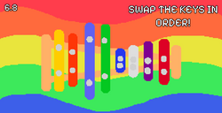
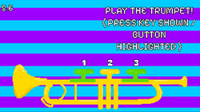

# Tempo Surge
A game inspired off of WarioWare, where you must complete many minigames to win!

You can play **Tempo Surge** at: https://marygoat.itch.io/tempo-surge
To start, just press run!

### Controls

- WASD / Arrow keys to move
- Space / W / Up arrow to jump
- Mouse click to interact with things
- 1 2 3 on keyboard to press trumpet keys
- Q E on the bongos
- A B C D E F G for the memorization minigame

### Features 

8 fast-paced minigames! Such as:

- Guitar Platformer - Grab the guitar picks as fast as possible!
- Note Clicker - Collect all the music notes in time!
- Tuner - Tune your sound before time ends!
- Wrong Order - Swap the xylophone keys into place!
- String the Harp - String the harp as soon as you can!
- Trumpet Player - Press the trumpet keys in the right order!
- Memorization - Press the right letters in the right order of the notes that appear!
- Bongo - Press the correct bongo in the right order!
- Metronome - Click when the pendelum of the metronome is in the middle!

- Chill Mode - Turn this on through Options to have more time during the minigames!

Made in Godot and was made for the Stardance Hackclub program, with the project: Make a WarioWare game. 
**Tempo Surge** was also made in order to learn Godot and to learn how to make games and art.

All art assets used in game were made by me :)

I will probably add more things in the game, as well as redesign some things that I didn't really like but didn't want to spend more time drawing.

Hope you have fun playing **Tempo Surge!**

### Images

### AI Usage

I used AI to help me debug some errors in the code as well as help me bring the fourth minigame to life, since I wasn't sure on what the best way of adding a swap object system would look like. I also used AI to help me improve the touch feedback animations and bring more life to the game.
